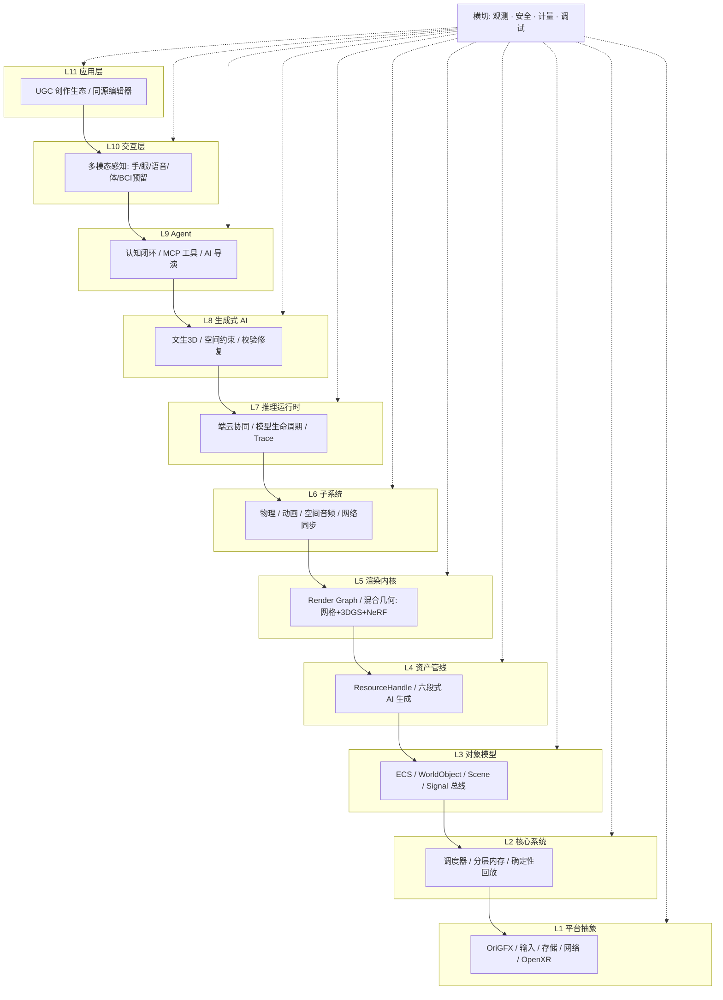

<div align="center">

# OriEra 世界引擎

**AI 原生、虚实融合、可自演化的开放数字世界运行时**

[](LICENSE)
[](https://oriera-engine.github.io/engine/)
[](https://github.com/OriEra-engine/engine/discussions)
[](CONTRIBUTING.md)
[](https://oriera-engine.github.io/engine/)

</div>

---

## 这是什么

OriEra 不是又一个游戏引擎。我们要做的是：在 PC、手机、网页、AR 眼镜（以及未来的脑机接口）上，跑一个**能被 AI 驱动、能持续自我演化、用户可以用自然语言创造内容**的实时 3D 世界。

架构上是 **11 层分层结构**，五端一等公民接入，脑机接口在 v1 只留位不接硬件。

## 在线体验

**🌐 https://oriera-engine.github.io/engine/**

6 个可玩 demo，浏览器直接打开：

| Demo | 展示 | 打开 |
|---|---|---|
| 01 Hello Triangle | L1 PAL + WebGPU 清屏三角形 | [▶](https://oriera-engine.github.io/engine/examples/01-hello-triangle/index.html) |
| 02 ECS Spawn | 20 万粒子 SoA ECS | [▶](https://oriera-engine.github.io/engine/examples/02-ecs-spawn/index.html) |
| 03 Physics Sandbox | 重力 + 碰撞 + 鼠标拖拽 | [▶](https://oriera-engine.github.io/engine/examples/03-physics/index.html) |
| 04 Agent Chat | 自然语言控制粒子 | [▶](https://oriera-engine.github.io/engine/examples/04-agent-chat/index.html) |
| 05 glTF Model | Three.js 加载 Duck 模型 | [▶](https://oriera-engine.github.io/engine/examples/05-gltf-model/index.html) |
| 06 Agent × Physics | 聊天指挥物理世界 | [▶](https://oriera-engine.github.io/engine/examples/06-agent-physics/index.html) |
| 07 WebGPU 1M Particles | 100 万粒子 GPU compute | [▶](https://oriera-engine.github.io/engine/examples/07-webgpu-particles/index.html) |

## 架构



## 五端接入

| 端 | 目录 | 状态 |
|---|---|---|
| PC (Win/macOS/Linux) | `platforms/pc/` | ✅ 骨架 |
| Mobile (iOS/Android) | `platforms/mobile/` | 📋 规划 |
| Web (Wasm + WebGPU) | `platforms/web/` | ✅ demo 已跑 |
| AR 眼镜 (visionOS / 骁龙 / WebXR) | `platforms/ar_glasses/` | 📋 重点适配 |
| 脑机接口（预留） | `platforms/bci_reserved/` | 🔒 仅 trait，v1 不实现 |

上层代码只读 `Capabilities` 位图，不写 `#[cfg(target_os)]`——加新端只改一个文件。

## 技术栈

| 层 | 首选技术 |
|---|---|
| 引擎主语言 | Rust（L1–L7 实时层） |
| Web 分发 | Wasm + WebGPU（wgpu 统一后端） |
| 对象模型 | ECS（SoA 布局，TypedArray 参考实现已跑） |
| 渲染 | wgpu / WebGPU，未来支持 3DGS 神经渲染 |
| 物理 | Jolt（Rust），Web 参考实现已跑 |
| Agent | LangGraph + MCP 协议（v1 规则解析，未来接 LLM） |
| 契约 | Protobuf + JSON Schema 2020-12 |
| 构建 | Cargo workspace + pnpm workspace |

## 快速开始

### 在线 demo（零安装）

直接打开 **https://oriera-engine.github.io/engine/**

### 本地跑 Web demo

```bash
git clone https://github.com/OriEra-engine/engine.git
cd engine
npx serve .
# 浏览器打开 http://localhost:3000
```

### Rust 引擎（需要 Rust 1.80+）

```bash
cargo run -p oriera-pc        # PC 端清屏窗口
cargo test --workspace         # 跑全部单元测试
cargo clippy --workspace -- -D warnings
```

## 贡献

我们欢迎任何形式的贡献——修 bug、写文档、加 demo、提 RFC。

- [贡献指南](CONTRIBUTING.md)
- [治理模式](GOVERNANCE.md)
- [路线图](ROADMAP.md)
- [行为准则](CODE_OF_CONDUCT.md)

## 协议

[Apache License 2.0](LICENSE) — 专利授权条款，云厂商友好。
