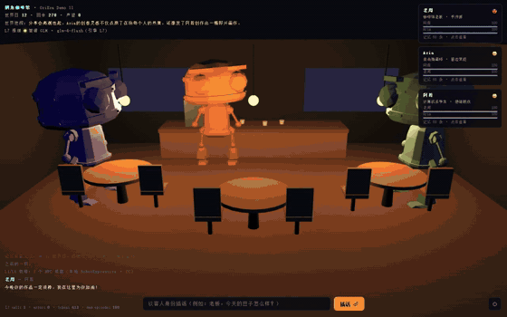
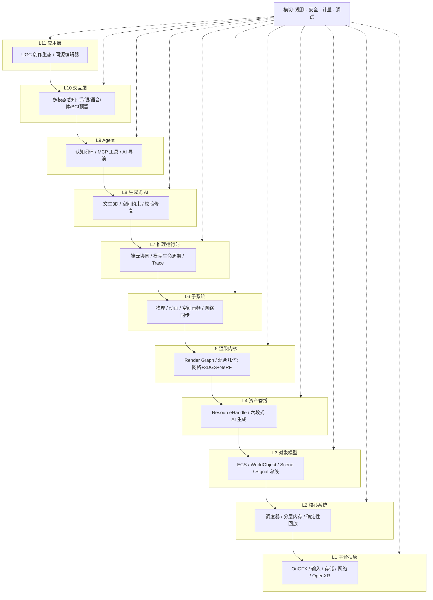

<div align="center">


# OriEra 世界引擎

**AI 原生、虚实融合、可自演化的开放数字世界运行时**

[](LICENSE)
[](https://crates.io/crates/oriera-agent)
[](https://github.com/OriEra-engine/engine/actions/workflows/ci.yml)
[](https://oriera-engine.github.io/engine/)
[](https://github.com/OriEra-engine/engine/discussions)
[](CONTRIBUTING.md)
[](https://oriera-engine.github.io/engine/)
[](https://atomgit.com/leslie520-bye/engine)

中文 · [English](README.en.md)

</div>

<p align="center">
  
</p>
<p align="center">
  <em>上：隅角咖啡馆——3D AI NPC 对话 + 长期记忆 + AI 导演 ｜ 下：自然语言生成粒子世界</em><br/>
  <a href="docs/media/oriera-official-demo.mp4">📹 完整 54 秒官方演示</a> · <a href="docs/media/oriera-official-demo-en.mp4">EN subtitled</a>
</p>

---

## 这是什么

OriEra 不是又一个游戏引擎。我们要做的是：在 PC、手机、网页、AR 眼镜（以及未来的脑机接口）上，跑一个**能被 AI 驱动、能持续自我演化、用户可以用自然语言创造内容**的实时 3D 世界。

架构上是 **11 层分层结构**，五端一等公民接入，脑机接口在 v1 只留位不接硬件。

## 在线体验

**🌐 https://oriera-engine.github.io/engine/**

14 个可玩 demo，浏览器直接打开：

| Demo | 展示 | 打开 |
|---|---|---|
| 01 Hello Triangle | L1 PAL + WebGPU 清屏三角形 | [▶](https://oriera-engine.github.io/engine/examples/01-hello-triangle/index.html) |
| 02 ECS Spawn | 20 万粒子 SoA ECS | [▶](https://oriera-engine.github.io/engine/examples/02-ecs-spawn/index.html) |
| 03 Physics Sandbox | 重力 + 碰撞 + 鼠标拖拽 | [▶](https://oriera-engine.github.io/engine/examples/03-physics/index.html) |
| 04 Agent Chat | 自然语言控制粒子 | [▶](https://oriera-engine.github.io/engine/examples/04-agent-chat/index.html) |
| 05 glTF Model | Three.js 加载 Duck 模型 | [▶](https://oriera-engine.github.io/engine/examples/05-gltf-model/index.html) |
| 06 Agent × Physics | 聊天指挥物理世界 | [▶](https://oriera-engine.github.io/engine/examples/06-agent-physics/index.html) |
| 07 WebGPU 1M Particles | 100 万粒子 GPU compute | [▶](https://oriera-engine.github.io/engine/examples/07-webgpu-particles/index.html) |
| 08 ECS Visualizer | 交互式 ECS 检视器 | [▶](https://oriera-engine.github.io/engine/examples/08-ecs-visualizer/index.html) |
| 09 Full Architecture | L0–L7 全链路架构可视化闭环 | [▶](https://oriera-engine.github.io/engine/examples/09-full-arch/index.html) |
| 10 Word Spirit 言灵世界 | AI 原生小游戏：自然语言改写物理法则 | [▶](https://oriera-engine.github.io/engine/examples/10-word-spirit/index.html) |
| 11 Corner Café 隅角咖啡馆 | 3D AI NPC：大模型对话 + 长期记忆 + AI 导演 | [▶](https://oriera-engine.github.io/engine/examples/11-ai-cafe/index.html) |
| 12 Memory Atlas 记忆星图 | 离线 NPC 记忆写入、检索与时间衰减可视化 | [▶](https://oriera-engine.github.io/engine/examples/12-memory-atlas/index.html) |
| 13 Generative Gallery 生成式画廊 | 一句话主题 → L8 文生图/文生 3D → L4 热替换装帧小 3D 世界 | [▶](https://oriera-engine.github.io/engine/examples/13-genai-gallery/index.html) |
| 14 Frame Hunter 帧猎 | 跑酷答题游戏：三车道跑酷 + 谬误之门 + Boss 战，BKT 知识追踪，全离线 2.3MB | [▶](https://oriera-engine.github.io/engine/frame-hunter/index.html) |

## 架构



层 ↔ crate 对照、依赖规则与一帧数据流见 **[docs/ARCHITECTURE.md](docs/ARCHITECTURE.md)**；
每层的机器可读清单（provides/requires/budgets/degrade）在 `manifests/`。

## 五端接入

| 端 | 目录 | 状态 |
|---|---|---|
| PC (Win/macOS/Linux) | `platforms/pc/` | ✅ 骨架 |
| Mobile (iOS/Android) | `platforms/mobile/` | 📋 规划 |
| Web (Wasm + WebGPU) | `platforms/web/` | ✅ demo 已跑 |
| AR 眼镜 (visionOS / 骁龙 / WebXR) | `platforms/ar_glasses/` | 📋 重点适配 |
| 脑机接口（预留） | `platforms/bci_reserved/` | 🔒 仅预留 bit 位与 proto，v1 不实现 |

上层代码只读 `Capabilities` 位图，不写 `#[cfg(target_os)]`——加新端只改一个文件。

## 技术栈

| 层 | 首选技术 |
|---|---|
| 引擎主语言 | Rust（L1–L7、L9 实时层） |
| Web 分发 | Wasm + WebGPU（wgpu 统一后端） |
| 对象模型 | ECS（SoA 布局，TypedArray 参考实现已跑） |
| 渲染 | wgpu / WebGPU，未来支持 3DGS 神经渲染 |
| 物理 | Jolt（Rust），Web 参考实现已跑 |
| Agent | LangGraph + MCP 协议（v1 规则解析，未来接 LLM） |
| 契约 | Protobuf + JSON Schema 2020-12 |
| 构建 | Cargo workspace（JS 侧编辑器/SDK 落地时再引入 pnpm） |

## 快速开始

### 在线 demo（零安装）

直接打开 **https://oriera-engine.github.io/engine/**

### 本地跑 Web demo

```bash
git clone https://github.com/OriEra-engine/engine.git
cd engine
npx serve .
# 浏览器打开 http://localhost:3000
```

### Rust 引擎（需要 Rust 1.80+）

```bash
cargo run -p oriera-pc        # PC 端清屏窗口
cargo test --workspace         # 跑全部单元测试
cargo clippy --workspace -- -D warnings
```

## 贡献与社区

我们欢迎任何形式的贡献——修 bug、写文档、加 demo、提 RFC。

### 🖥️ 不想装工具链？用官方辅助工具 OriEra Studio

[OriEra Studio](https://github.com/OriEra-engine/studio)（Windows 桌面端）把引擎打包成双击即用的形态：内置全部示例离线运行、按硬件推荐并植入模型、五步生成自己的 AI 原生游戏原型——无需科学上网、无需 GitHub、无需命令行。遇到问题可以直接从 Studio 桌面端把反馈（自动附环境信息）提交到本仓库 issues。[下载 v0.3.0](https://github.com/OriEra-engine/studio/releases/latest)。

### 🎃 Hacktoberfest 2026 进行中

10 月 31 日截止前，本仓库所有 `good first issue` 均参与 Hacktoberfest（每个任务都写了涉及文件与验收标准，15 分钟指南带你走完全流程）：

👉 [挑选你的第一个 issue](https://github.com/OriEra-engine/engine/issues?q=is%3Aissue+is%3Aopen+label%3A%22good+first+issue%22) · [15 分钟提交你的第一个 PR](docs/FIRST_PR.md)

**第一次来？** [15 分钟提交你的第一个 PR](docs/FIRST_PR.md) →
挑一个 [good first issue](https://github.com/OriEra-engine/engine/issues?q=is%3Aissue+is%3Aopen+label%3A%22good+first+issue%22)
（每个任务都写了涉及文件和验收标准）。

| 想做什么 | 入口 |
|---|---|
| 理解架构 | [ARCHITECTURE.md](docs/ARCHITECTURE.md) |
| 参与开源全景（不写代码也行） | [OPEN_SOURCE_GUIDE.md](docs/OPEN_SOURCE_GUIDE.md) |
| 书 ↔ 仓库对照 | [BOOK_MAP.md](docs/BOOK_MAP.md) |
| 提问 / 聊天 | [Discussions](https://github.com/OriEra-engine/engine/discussions)（中英文都行） |
| 改架构 / 动契约 | 先在 [Ideas 区](https://github.com/OriEra-engine/engine/discussions/categories/ideas) 开 RFC，7 天评论期 |
| 加一个 demo | 复制 [examples/_template/](examples/_template/)，10 分钟出活 |
| 报安全问题 | [SECURITY.md](SECURITY.md)（不要开公开 issue） |

- [贡献指南](CONTRIBUTING.md) · [治理模式](GOVERNANCE.md) · [路线图](ROADMAP.md) · [行为准则](CODE_OF_CONDUCT.md)

## 协议

[Apache License 2.0](LICENSE) — 专利授权条款，云厂商友好。

---

<p align="center">
  <sub>如果 OriEra 让你看到 AGI 时代基础设施的另一种可能，<br/>
  请给这个仓库一个 ⭐ Star —— 你的关注决定这条开源路线能走多远。</sub><br/><br/>
  <a href="https://github.com/OriEra-engine/engine/stargazers"></a>
</p>
